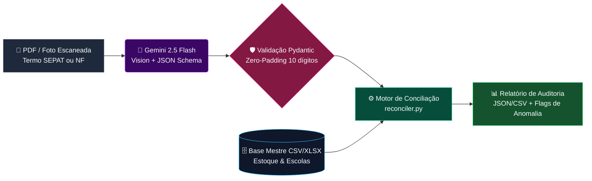

<div align="center">

# 🛡️ Patrimônio OCR Auditor
### Automação de Rastreabilidade & Conciliação de Ativos Públicos com IA

<p align="center">
  Pipeline determinístico em Python para extração óptica estruturada (OCR via <strong>Google Gemini 2.5 Flash</strong>) e auditoria automatizada de Termos de Responsabilidade Patrimonial (padrão SEPAT) e Notas Fiscais.
</p>

<!-- BADGES -->
<p align="center">
  
  
  
  
</p>

</div>

---

## 🎯 Contexto Real & Impacto Operacional

Em operações de implantação de laboratórios públicos de ciência e tecnologia em larga escala (**+1.000 ativos físicos** distribuídos em dezenas de unidades escolares, avaliados em **~R$ 3,28 milhões**), a conferência manual de Termos de Responsabilidade escaneados gera gargalos severos:

| Gargalo Operacional | Como ocorria manualmente | Solução do Pipeline |
| :--- | :--- | :--- |
| **Erros Tipográficos de Lote** | Lotes (ex: 10 Smart TVs) têm o valor global (`R$ 20.990,80`) impresso em cada linha unitária (`R$ 2.099,08`), distorcendo a contabilidade. | **Heurística de Lote:** Detecta múltiplos (`5x`, `10x`, `15x`, `20x`) e corrige o custo unitário mantendo a flag de auditoria. |
| **Omissão / Troca de Chassi** | Equipamentos tombados sem Número de Série no papel ou com seriais trocados entre unidades escolares. | **Batimento Cruzado:** Compara o serial extraído da imagem contra a Base Mestre e classifica a divergência na hora. |
| **Quebra de Padrão de Tombo** | Perda de zeros à esquerda em números de patrimônio de 10 dígitos ao exportar para planilhas comuns. | **Zero-Padding via Pydantic:** Normaliza qualquer entrada numérica para o padrão estrito de 10 dígitos (`50793749` ➔ `0050793749`). |

---

## 🏗️ Arquitetura do Pipeline

O motor opera em duas etapas desacopladas: **Extração Multimodal Estruturada** (`temperature=0.0`) seguida pelo **Motor Determinístico de Conciliação**.



---

## ⚡ Principais Funcionalidades & Engenharia

- **`src/ocr_extractor.py` — Extração Multimodal Determinística:** Utiliza `response_schema` nativo do SDK `google-genai` com `temperature=0.0` para converter PDFs escaneados diretamente em objetos tipados, proibindo alucinação de seriais ausentes.
- **`src/schemas.py` — Sanitização Estrita de Tombamento:** Validadores `@field_validator` do Pydantic que garantem integridade tipográfica dos códigos de patrimônio (10 dígitos) e valores monetários antes do processamento.
- **`src/reconciler.py` — Normalização Heurística & Auditoria de Chassi:** Classifica instantaneamente cada ativo em:
  - ✅ `CONFORME`
  - ⚠️ `VALOR DE LOTE NORMALIZADO`
  - ❌ `DIVERGÊNCIA DE SÉRIE/IMEI`
  - 🚨 `FALTA NÚMERO DE SÉRIE NO TERMO`

<details>
  <summary><strong>🔎 Clique para ver um exemplo da Saída da Auditoria (Terminal / JSON)</strong></summary>
  <br>

```text
================================================================================
RELATÓRIO DE CONCILIAÇÃO PATRIMONIAL - UNIDADE ESCOLAR DEMO
================================================================================
[TOMBO: 0050793749] Smart TV 50" 4K
 ├─ Status: ⚠️ VALOR DE LOTE NORMALIZADO (Impresso: R$ 20.990,80 -> Auditado: R$ 2.099,08 [Lote 10x])
 └─ Serial: SN-TV50-998811 (CONFORME COM BASE MESTRE)

[TOMBO: 0050793750] Impressora 3D Fechada
 ├─ Status: 🚨 FALTA NÚMERO DE SÉRIE NO TERMO
 └─ Ação Requerida: Solicitar foto da etiqueta física do chassi na unidade escolar.
================================================================================
```
</details>

---

## 📂 Estrutura do Repositório

```text
patrimonio-ocr-auditor/
├── src/
│   ├── schemas.py          # Contratos de dados Pydantic e sanitização de tombos (10 dígitos)
│   ├── ocr_extractor.py    # Integração Google Gemini 2.5 Flash (Structured Outputs)
│   └── reconciler.py       # Motor de regras contábeis, heurística de lote e cruzamento de seriais
├── examples/
│   └── run_demo_audit.py   # Simulação completa de auditoria (roda offline sem API Key)
└── requirements.txt        # Dependências do projeto
```

---

## 🚀 Como Executar Localmente

### 1. Clonar o repositório e instalar dependências
```bash
git clone [https://github.com/gab3souzza/patrimonio-ocr-auditor.git](https://github.com/gab3souzza/patrimonio-ocr-auditor.git)
cd patrimonio-ocr-auditor
pip install -r requirements.txt
```

### 2. Rodar a simulação de auditoria (Sem necessidade de API Key)
Para testar imediatamente o motor de regras e conciliação com dados sintéticos de demonstração:
```bash
python examples/run_demo_audit.py
```

### 3. Executar OCR em documentos reais (PDF/Imagem)
Configure sua chave de API do Google Gemini e utilize a função `extrair_termo_de_arquivo` de `src/ocr_extractor.py`:
```bash
export GEMINI_API_KEY="sua_chave_aqui"
```

---

> [!IMPORTANT]
> **Conformidade, Segurança e Privacidade (LGPD / SEI)**  
> Todos os dados contidos na pasta `examples/` são **100% sintéticos e anonimizados**, projetados exclusivamente para demonstrar a arquitetura e a engenharia do pipeline sem expor informações institucionais, fiscais ou pessoais sensíveis.
