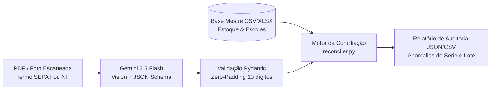

# 🔍 Patrimônio OCR Auditor — Automação de Rastreabilidade & Conciliação de Ativos com IA

Pipeline em **Python** para extração óptica estruturada (OCR via **Google Gemini 2.5 Flash Structured Outputs**) e auditoria automatizada de **Termos de Responsabilidade de Bens Móveis (padrão SEPAT)** e Notas Fiscais contra bases mestras de inventário.

---

## 🎯 Contexto Real & Impacto Operacional

Em operações de implantação de laboratórios públicos de ciência e tecnologia em larga escala (rede estadual com dezenas de unidades escolares e **+1.000 ativos físicos avaliados em ~R$ 3,28 milhões**), a conferência manual de Termos de Responsabilidade escaneados gera gargalos severos:
- **Erros tipográficos em termos legados:** Lotes de equipamentos (ex: 10 Smart TVs) frequentemente têm o valor global do lote (`R$ 20.990,80`) impresso em cada linha unitária (`R$ 2.099,08`), distorcendo auditorias contábeis.
- **Omissão ou divergência de Número de Série/IMEI:** Equipamentos tombados sem serial registrado no documento físico ou com troca de chassi entre unidades escolares.
- **Despadronização de Tombos:** Perda de zeros à esquerda em números de patrimônio de 10 dígitos ao exportar para planilhas comuns.

Este motor automatiza a leitura de PDFs e fotos de campo, aplica validação determinística via **Pydantic** e executa o batimento cruzado com o estoque central em segundos.

---

## 🏗️ Arquitetura do Pipeline



---

## 🚀 Principais Funcionalidades

- **Extração Multimodal Determinística (`src/ocr_extractor.py`):** Utiliza `response_schema` nativo da SDK `google-genai` com `temperature=0.0` para converter PDFs escaneados diretamente em objetos tipados, proibindo alucinação de seriais ausentes.
- **Sanitização de Tombamento (`src/schemas.py`):** Validador automático que normaliza qualquer entrada numérica para o padrão estrito de 10 dígitos com zeros à esquerda (ex.: `50793749` -> `0050793749`).
- **Normalização Heurística de Lotes (`src/reconciler.py`):** Detecta automaticamente quando o valor impresso no termo corresponde a múltiplos de lote (5x, 10x, 15x, 20x) em relação ao valor unitário de referência e corrige o custo auditado sem perder o rastreio da anomalia.
- **Auditoria de Chassi/IMEI:** Classifica instantaneamente cada ativo em `CONFORME`, `DIVERGÊNCIA DE SÉRIE/IMEI`, `FALTA NÚMERO DE SÉRIE NO TERMO` ou `VALOR DE LOTE NORMALIZADO`.

---

## 🛠️ Como Executar Localmente

### 1. Clonar e instalar dependências
```bash
git clone https://github.com/SEU-USUARIO/patrimonio-ocr-auditor.git
cd patrimonio-ocr-auditor
pip install -r requirements.txt
```

### 2. Rodar a simulação de auditoria (Sem necessidade de API Key)
Para testar imediatamente o motor de regras e conciliação com dados sintéticos de demonstração:
```bash
python examples/run_demo_audit.py
```

### 3. Executar OCR em documentos reais (PDF/Imagem)
Configure sua chave de API do Google Gemini e utilize a função `extrair_termo_de_arquivo` de `src/ocr_extractor.py`:
```bash
export GEMINI_API_KEY="sua_chave_aqui"
```

---

## 🔒 Conformidade e Privacidade (LGPD / SEI)
Todos os dados contidos na pasta `examples/` são **100% sintéticos e anonimizados**, projetados exclusivamente para demonstrar a engenharia do pipeline sem expor informações institucionais sensíveis.
